```{=html}
<div class="project-grid">

  <div class="project-card">
    <div class="project-img">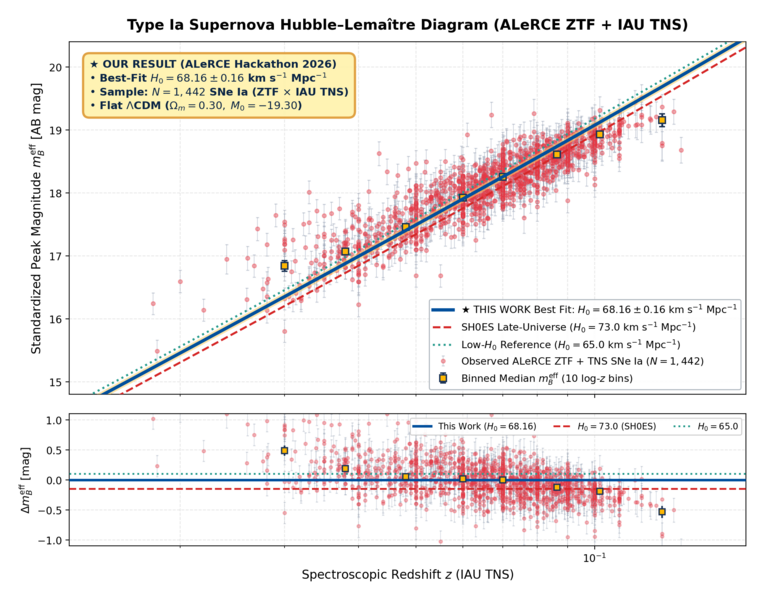</div>
    <div class="project-body">
      <h3>ALeRCE · Hubble Constant from ZTF SNe Ia</h3>
      <div class="project-tags"><span>Cosmology</span><span>ZTF</span><span>Rubin/LSST</span></div>
      <p>Built at the ALeRCE Hackathon 2026: an estimate of H<sub>0</sub> from 1,442 Type Ia supernovae seen by ZTF, plus early checks of supernova candidates from Rubin/LSST.</p>
      <a class="project-link" href="https://github.com/jurados/ALeRCE-ZTFLSST-HubbleConstant" target="_blank">View on GitHub →</a>
    </div>
  </div>

  <div class="project-card">
    <div class="project-img">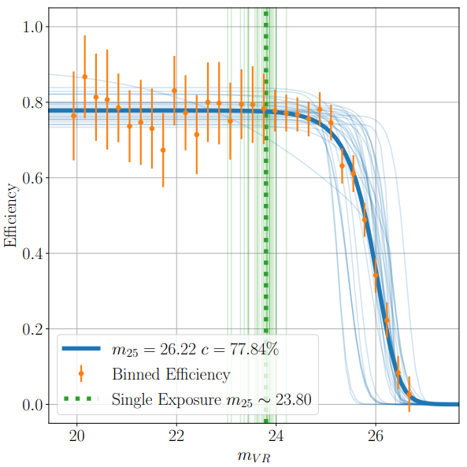</div>
    <div class="project-body">
      <h3>KBMOD-StampNet</h3>
      <div class="project-tags"><span>Deep Learning</span><span>CNN</span><span>Solar System</span></div>
      <p>A CNN that separates real trans-Neptunian objects from false positives in KBMOD shift-and-stack searches. It compares a basic CNN, a ResNet-56 and a transfer-learned ResNet-50.</p>
      <a class="project-link" href="https://github.com/jurados/KBMOD-StampNet" target="_blank">View on GitHub →</a>
    </div>
  </div>

  <div class="project-card">
    <div class="project-img">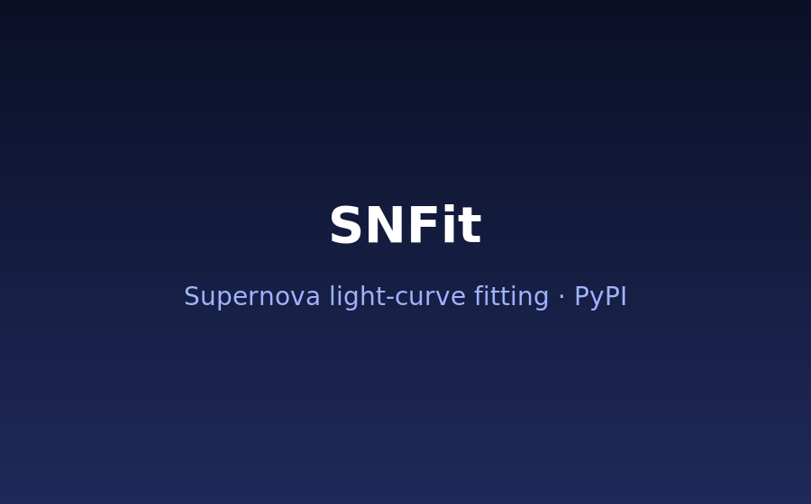</div>
    <div class="project-body">
      <h3>SNFit</h3>
      <div class="project-tags"><span>Python package</span><span>Supernovae</span><span>CodeAstro 2025</span></div>
      <p>A pip-installable package for fitting supernova light curves and estimating distances from peak brightness, developed together with other participants at CodeAstro 2025.</p>
      <a class="project-link" href="https://github.com/moira-andrews/SNFit" target="_blank">View on GitHub →</a>
    </div>
  </div>

  <div class="project-card">
    <div class="project-img">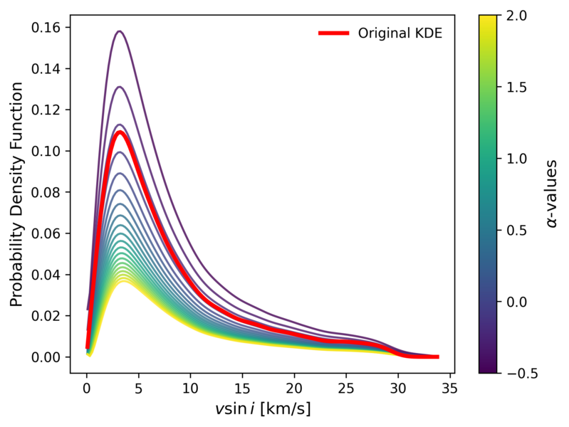</div>
    <div class="project-body">
      <h3>TrueStarVrotVelocity</h3>
      <div class="project-tags"><span>Stellar Astrophysics</span><span>Inverse problems</span></div>
      <p>Recovers the true distribution of stellar rotational velocities from measured <i>v</i> sin <i>i</i>, using Tikhonov regularization and models in which stellar spin axes are not randomly oriented.</p>
      <a class="project-link" href="https://github.com/jurados/TrueStarVrotVelocity" target="_blank">View on GitHub →</a>
    </div>
  </div>

  <div class="project-card">
    <div class="project-img">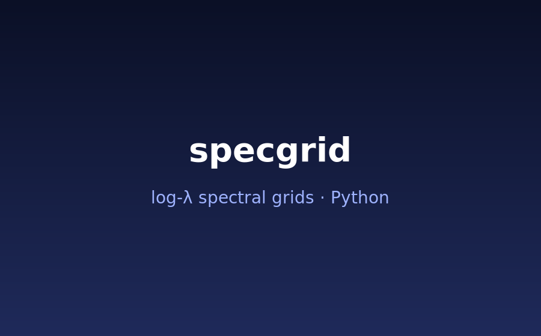</div>
    <div class="project-body">
      <h3>specgrid</h3>
      <div class="project-tags"><span>Python library</span><span>Spectroscopy</span></div>
      <p>Places astronomical spectra on a fixed log-spaced wavelength grid with constant velocity resolution. It also handles continuum division and apodization.</p>
      <a class="project-link" href="https://github.com/jurados/specgrid" target="_blank">View on GitHub →</a>
    </div>
  </div>

  <div class="project-card">
    <div class="project-img">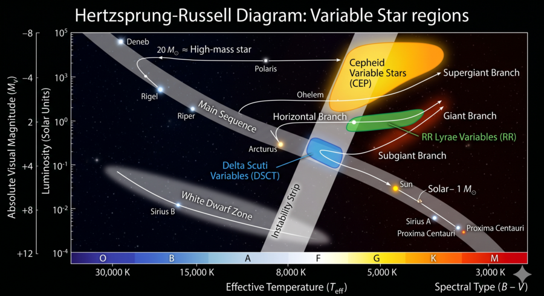</div>
    <div class="project-body">
      <h3>AS4501 · Astroinformatics</h3>
      <div class="project-tags"><span>Teaching</span><span>Machine Learning</span></div>
      <p>Notebooks and exercises I wrote as teaching assistant for the Astroinformatics course at Universidad de Chile, applying machine learning and deep learning to real astronomical data.</p>
      <a class="project-link" href="https://github.com/jurados/AS4501_Astroinformatic" target="_blank">View on GitHub →</a>
    </div>
  </div>

  <div class="project-card">
    <div class="project-img">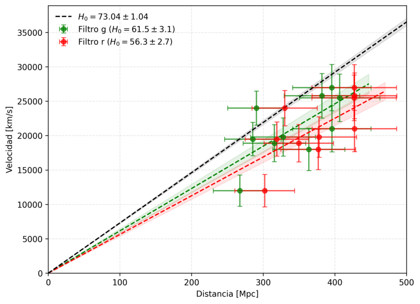</div>
    <div class="project-body">
      <h3>SNe Ia Cosmology · AS2001</h3>
      <div class="project-tags"><span>Teaching</span><span>ALeRCE</span><span>Cosmology</span></div>
      <p>A hands-on activity for General Astronomy: students use ZTF light curves from ALeRCE to build a Hubble diagram of Type Ia supernovae and estimate H<sub>0</sub>.</p>
      <a class="project-link" href="https://github.com/jurados/SNeIaCosmologiaAS2001" target="_blank">View on GitHub →</a>
    </div>
  </div>

  <div class="project-card">
    <div class="project-img">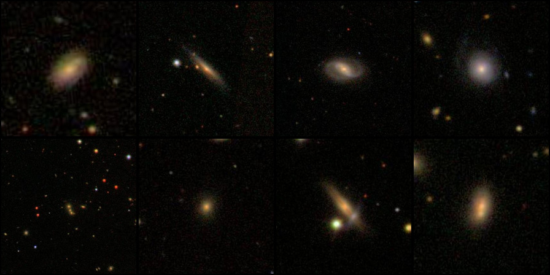</div>
    <div class="project-body">
      <h3>Galaxy Classifier</h3>
      <div class="project-tags"><span>Outreach</span><span>Galaxy Zoo</span></div>
      <p>A simple galaxy classifier trained on Galaxy Zoo images, made for an IDIA + Junior Achievement Chile outreach activity with secondary-school students.</p>
      <a class="project-link" href="https://github.com/jurados/ClasificadorGalaxias" target="_blank">View on GitHub →</a>
    </div>
  </div>

  <div class="project-card">
    <div class="project-img">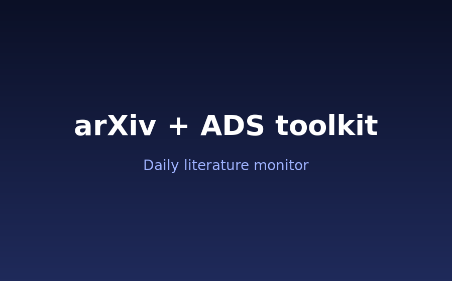</div>
    <div class="project-body">
      <h3>arXiv + ADS Toolkit</h3>
      <div class="project-tags"><span>Automation</span><span>Literature</span></div>
      <p>A daily arXiv monitor that sends alerts by WhatsApp, together with NASA ADS tools for building literature tables for a research topic.</p>
      <a class="project-link" href="https://github.com/jurados/arxiv-ads-toolkit" target="_blank">View on GitHub →</a>
    </div>
  </div>

  <div class="project-card">
    <div class="project-img">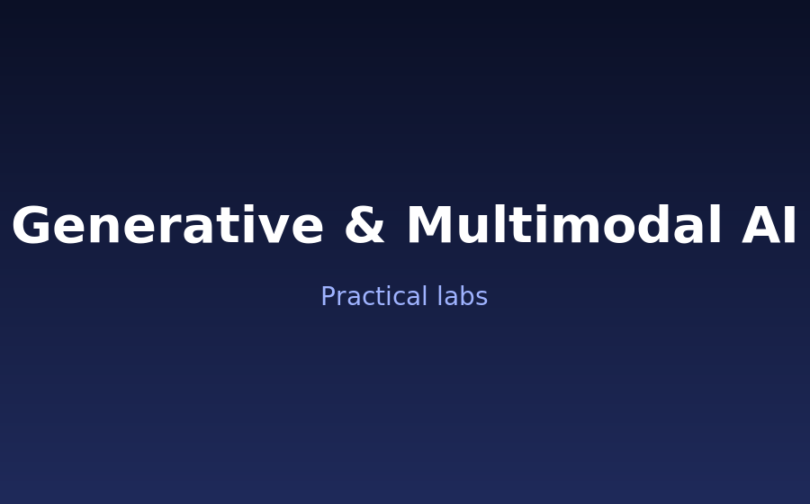</div>
    <div class="project-body">
      <h3>Generative &amp; Multimodal AI</h3>
      <div class="project-tags"><span>Generative models</span><span>Labs</span></div>
      <p>Hands-on labs on generative and multimodal artificial intelligence.</p>
      <a class="project-link" href="https://github.com/jurados/GenerativeMultimodalAI" target="_blank">View on GitHub →</a>
    </div>
  </div>

  <div class="project-card">
    <div class="project-img">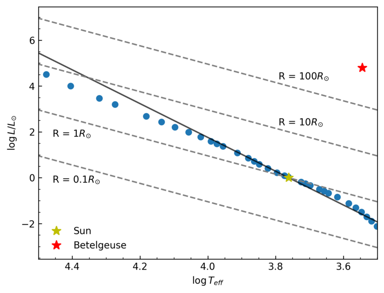</div>
    <div class="project-body">
      <h3>Hertzsprung–Russell Diagram</h3>
      <div class="project-tags"><span>Stellar Astrophysics</span><span>Python</span></div>
      <p>A theoretical approximation of the Hertzsprung–Russell diagram from mass–luminosity and mass–radius relations, written for a stellar astrophysics course.</p>
      <a class="project-link" href="https://github.com/jurados/Hertzsprung-Rusell-Diagram" target="_blank">View on GitHub →</a>
    </div>
  </div>

</div>

<p style="text-align:center; margin-top:2.5rem;">
  <a class="project-link" href="https://github.com/jurados" target="_blank">More on github.com/jurados →</a>
</p>
```
