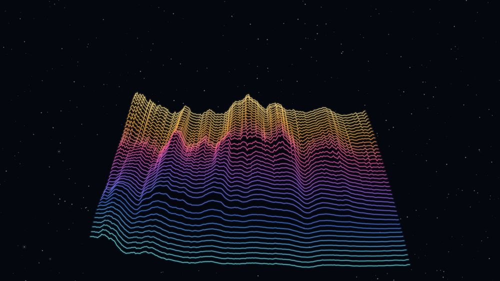
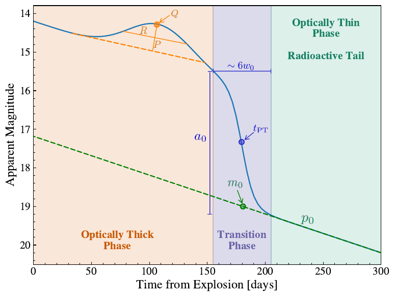
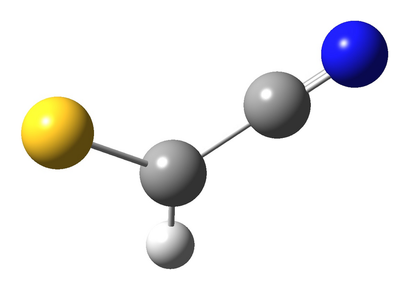

My research sits between **stellar astrophysics** and **astroinformatics**. I am interested in how massive stars live and die, and in building statistical and machine-learning tools for the large data sets that surveys such as ZTF and the Vera C. Rubin Observatory (LSST) are producing. Below are the three projects I am working on. All of them are **still in progress and not yet published**, so this page gives only a general picture. More details will come once the papers are out.

```{=html}
<div class="research-block">
  <div></div>
  <div>
    <span class="research-status">PhD thesis · in preparation</span>
    <h2>Multimodal deep learning for supernovae</h2>
    <p>Most methods that classify and characterize transients use only light curves. In my thesis, supervised by <a href="https://scholar.google.com/citations?user=ptRI8_sAAAAJ&hl=en" target="_blank">Dr. Francisco Förster</a>, I am building a <b>variational autoencoder</b> that learns from <b>light curves and spectra together</b>. The model encodes each supernova in a latent space whose coordinates have a physical meaning, and decodes it into a spectral energy distribution that can be compared directly with the observations. It extends the ParSNIP model (Boone 2021) and uses ZTF photometry from the <a href="https://alerce.online" target="_blank">ALeRCE</a> broker and spectra from WISeREP. It is written in PyTorch and trained on high-performance computing clusters.</p>
  </div>
</div>

<div class="research-block">
  <div></div>
  <div>
    <span class="research-status">Paper in preparation</span>
    <h2>The transition phase of Type II supernovae</h2>
    <p>After the plateau, the light curves of hydrogen-rich (Type II) supernovae drop quickly before they settle onto the radioactive tail. This short <b>transition phase</b> has received much less attention than the plateau or the tail. With Dr. Claudia P. Gutiérrez, Dr. Santiago González-Gaitán and Dr. Laureano Martinez, I characterize this transition in a large sample of observed supernovae using an analytic model and Bayesian (MCMC) fitting. We then compare the observations with hydrodynamical explosion models to learn what the transition can tell us about the progenitor star and the explosion.</p>
  </div>
</div>

<div class="research-block">
  <div></div>
  <div>
    <span class="research-status">Ongoing</span>
    <h2>Sulfur-bearing molecules in IRC+10216</h2>
    <p>IRC+10216 is the nearest carbon-rich AGB star and one of the richest chemical laboratories in the sky. I combine <b>quantum-chemistry calculations</b> (structures, energies and spectroscopic constants of isomers) with <b>millimeter observations from the APEX telescope</b> to search for new sulfur-bearing molecules in its circumstellar envelope, such as HCSCN, HCSCCH and c-C<sub>2</sub>H<sub>2</sub>S. I have presented this work at the Chilean Astrochemistry School and at the 1st Colombian Symposium on Astrochemistry.</p>
  </div>
</div>
```

If you want to know more or would like to collaborate, write to me at <a href="mailto:sjurado@das.uchile.cl">sjurado@das.uchile.cl</a>.
