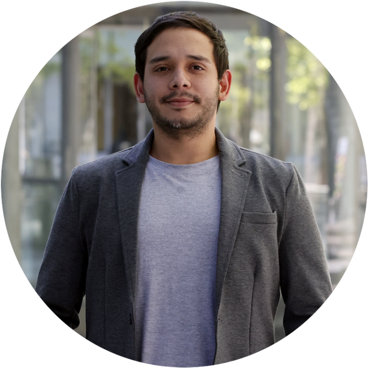

<!-- Sidebar -->

::::::: columns
::: {.column .aside width="100%"}
<center>

<a href='https://jurados.github.io' target='_blank'>  </a>

<p style="color:black; font-size:20px">

Steve Jurado

</p>

</center>

<center><span style="font-size: 1.5em;"> <a href='https://jurados.github.io' target='_blank'><i class="fa fa-home"></i></a> <a href='https://github.com/jurados' target='_blank'><i class="fa-brands fa-github"></i></a> <a href='https://twitter.com/SteveJurado' target='_blank'><i class="fa-brands fa-twitter"></i></a> <a href='https://www.facebook.com/steve.juradopinilla' target='_blank'><i class="fa-brands fa-facebook"></i></a></center>

</span>

### Download

<center><a href="/assets/pdfs/CV_SteveJurado.pdf" target="_blank"></a></center>

### Contact

<i class="fa-solid fa-envelope"></i> sjurado\@das.uchile.cl <br> <i class="fa-brands fa-linkedin"></i> <a href='https://www.linkedin.com/in/astrojurados/' target='_blank'>astrojurados</a> <br> <i class="fa-brands fa-github"></i> <a href='https://github.com/jurados' target='_blank'>jurados</a>

### Languages

**Spanish:** Native <br> **English:** B2

### Skills

#### Coding

-   Python (advanced)
-   SQL
-   C
-   Bash

#### ML / DL

-   PyTorch
-   scikit-learn
-   TensorFlow
-   Weights & Biases

#### Statistics

-   Bayesian inference
-   MCMC (emcee)
-   Density estimation

#### LLMs / Agents

-   LLM APIs
-   Model Context Protocol (MCP)

#### Astronomy software

-   iSpec
-   IRAF
-   Gaussian

#### Infrastructure

-   Git/GitHub, Linux
-   HPC (SLURM)
-   pip packaging, LaTeX
:::

::: {.column width="5%"}
:::

::: columns
:::

::: {.column width="70%"}
<!-- Functions -->

````{=html}
<!--
```{r}
col_br <- function(col){
    dplyr::if_else(
      !is.na(col) & col != "N/A|NA", 
      paste0(col, ""),
      ""
    )
}
col_br_loc <- function(col){
    dplyr::if_else(
      !is.na(col) & col != "N/A|NA", 
      paste0('<i class="fa-solid fa-location-dot"></i> ', col),
      ""
    )
}
create_section <- function(cv_data, section_name){
  cv_data |>
    dplyr::mutate(in_resume = as.character(in_resume),
                  end = tidyr::replace_na(end, 9999),
                  loc = dplyr::if_else(loc == "Online", NA_character_, loc)) |>
    dplyr::filter(in_resume %in% c("TRUE", "VERDADEIRO"), section == section_name) |>
    dplyr::select(section:description_1) |>
    dplyr::arrange(desc(end), desc(start)) |>
    dplyr::mutate(
      date =
        dplyr::case_when(
          end == 9999 ~ glue::glue("Current <br> | <br> {start}"),
          end != start ~ glue::glue("{end} <br> | <br> {start}"),
          end == start ~ glue::glue("{end}"),
          TRUE ~ ""
        ) ,
      .before = everything()
    ) |>
    dplyr::mutate(
      main_text =
        glue::glue(
          "**{title}** <br> {col_br(institution)} {col_br(description_1)} {col_br_loc(loc)}"),
      .after = date
    ) |>
    dplyr::select(-c(start, end, section, title, institution, loc, description_1)) |>
    gt::gt() |>
    gt::fmt_markdown(columns = c(date, main_text)) |> 
    gt::tab_options(column_labels.hidden = TRUE, table.width = gt::pct(100)) |> 
    gt::cols_align(align = "left", columns = main_text)
}
```
-->
````

<!-- Main content -->

# Bryam Steve Pinilla Jurado

## Ph.D(c) in Astronomy
:::
:::::::

```{=html}
<!--
<p style="text-align:justify">

Professional astronomer with a seven-semester chemistry degree and interests in natural and exact sciences, particularly astrophysics, mathematics, chemistry, and computer science, as well as work as a data scientist. Experience as a teacher of secondary basic education and higher education teaching physics, mathematics, and chemistry. Knowledgeable in conducting research and scientific communication. Group management skills, the handling of programs such as Python, SQL, and R, the handling of office automation tools, and the capacity and ability to simplify complex knowledge. A professional who excels at active listening, assertive communication, responsibility, planning, sensitivity to guidelines, organization, quality focus, activity control, learning and professional development, and professional analysis and problem solving. 

</p>
-->
```

##  **Education**

 Universidad de Chile, Santiago, Chile \| Ph.D. in Sciences, Astronomy \| March 2023 - December 2026 (expected)

<center>**Thesis:** *"Combining Theory and Multimodal Observations to Classify and Characterize Supernovae."* Under the supervision of <a href='https://scholar.google.com/citations?user=ptRI8_sAAAAJ&hl=en'>Dr. Francisco Förster Burón</a>.</center>

<p style="text-align:justify">

*Qualifying examination passed in April 2024; thesis project approved in May 2024. All mandatory coursework completed (Radiative Processes, Observational Astronomy, Galactic Astronomy, Galaxies, Research Workshops I–IV), plus elective courses in Machine Learning and Astroinformatics.*

</p>

 Universidad de Antioquia, Medellín, Colombia \| B.Sc. in Astronomy, graduating rank 1/10 \| March 2014 - July 2022

<center>**Thesis:** *"Spectral characterization of the exoplanet host stars HAT-P-11 and HD 179949 with the TIGRE telescope."* Under the supervision of <a href='https://scholar.google.com/citations?user=tOYfRkkAAAAJ&hl=es'>Dr. Lauren Flor-Torres</a> & <a href='https://scholar.google.com/citations?user=HXHGks0AAAAJ&hl=en'> Dr. Camilo Delgado-Correal</a>.</center>

## <i class="fa-solid fa-meteor"></i> **Research Interests**

 **Astroinformatics & Astrostatistics.** Machine learning and deep learning applied to astronomical data; multimodal generative models; classification and characterization of transient events; large-scale data analysis.

 **Stellar Astrophysics.** Stellar evolution, stellar spectroscopy, supernovae and transient phenomena.

 **Astrochemistry.** Computational and observational searches for molecular species in circumstellar environments.

 **Physics-Informed Neural Networks (PINNs).**

##  **Research Experience**

 2024 – Present \| Doctoral research — Multimodal classification of transients \| Universidad de Chile, Santiago, Chile.

<p style="text-align:justify">

*Extension of a variational autoencoder architecture (ParSNIP, Boone 2021) to incorporate multimodality, a novel feature in this research area. Construction of the full data pipeline: ingestion of light curves from the ALeRCE broker and of spectra from the WISeREP database, with preprocessing, smoothing and filtering of irregular time series. Implemented in PyTorch on HPC infrastructure. Developed in consultation with Prof. Andrew Connolly (University of Washington; Director of the eScience Institute and of DiRAC).*

</p>

 2023 – Present \| Astrochemistry — Sulfur-bearing molecules in IRC+10216 \| Universidad de Chile, Santiago, Chile.

<p style="text-align:justify">

*Computational and observational search for sulfur-bearing molecules (HCSCN, HCSCCH, c-C<sub>2</sub>H<sub>2</sub>S) around the carbon star IRC+10216, using data from the APEX telescope.*

</p>

 2022 – 2024 \| Junior Researcher \| Fundación Universidad del Valle — Macondo Astronomy & Astrophysics Group (GAAM), Cali, Colombia \| Collaboration with Dr. Lauren Flor-Torres and Dr. Camilo Delgado-Correal.

 2021 – 2022 \| RECA Research Internship \| International collaboration, Remote.

<p style="text-align:justify">

*Statistical characterization of the transition phase in the light curves of hydrogen-rich supernovae, to constrain their progenitors and explosion properties. Parameter estimation carried out within a Bayesian framework using Markov Chain Monte Carlo (MCMC) sampling, including posterior inference and uncertainty quantification. Supervised by Dr. Claudia P. Gutiérrez (Universitat de Barcelona) and Dr. Santiago González-Gaitán (CENTRA, Universidade de Lisboa).*

</p>

 2021 \| Project Leader — 100 Hours 100 Schools \| IASC / Las Cumbres Observatory, Remote.

<p style="text-align:justify">

*Coordination of allocated observing time (90-minute blocks yielding 7–9 images per target) and delivery of analysis sessions on deep-sky objects, planets and minor bodies with school students.*

</p>

## <i class="fa-solid fa-file-lines"></i> **Publications**

 **Jurado, S.**, Gutiérrez, C. P. & González-Gaitán, S., *"Characterization of the Transition Phase in the Light Curves of Hydrogen-Rich Supernovae"*, in preparation.

 **Jurado, S.** & Förster, F., *"Multimodal Physical Variational Autoencoder for Supernova Light Curves and Spectra"*, in preparation.

## <i class="fa-solid fa-person-chalkboard"></i> **Conference Presentations**

 2025 \| IV Chilean Astrochemistry School \| Talk: Computational and Observational Search for Sulfur-Bearing Molecules using the APEX telescope. Also served on the organizing (logistics) committee.

 2024 \| First LSST Latin America Meeting, Universidad de La Serena, La Serena, Chile \| Poster: Combining Theory and Multimodal Observations to Classify and Characterize Transient Events.

 2024 \| 1st Colombian Symposium on Astrochemistry \| Talk: Computational and Observational Search for Sulfur-Bearing Molecules in the carbon star IRC+10216 using the APEX telescope.

 2023 \| Workshop in Computational Chemistry and Molecular Spectroscopy, Concón, Chile \| Poster: Computational and Observational Search for HCSCN, HCSCCH and c-C<sub>2</sub>H<sub>2</sub>S Sulfur Molecules around the carbon star IRC+10216.

 2022 \| Colombian Meeting of Astronomy & Astrophysics (COCOA), Tunja, Colombia \| Talk.

 2021 \| <a href='https://sn-crisp.github.io/CRISP2021/' target='_blank'>Correcting Reddening Intelligently for Supernova Probes (CRISP)</a>, virtual \| Talk: Characterization of the Light-Curve Transition of Hydrogen-Rich Supernovae.

 2021 \| <a href='https://sites.google.com/view/supervirtual2021' target='_blank'>SuperVirtual: A Virtual Conference on Supernovae and Related Transients</a>, virtual \| Poster: Characterization of the Light-Curve Transition of Hydrogen-Rich Supernovae.

##  **Software & Open-Source Projects**

 2025 \| <a href='https://github.com/moira-andrews/SNFit' target='_blank'>SNFit</a> — Python package for supernova light-curve fitting, CodeAstro \| pip-installable package for polynomial fitting of supernova light curves and distance estimation from peak luminosity. Collaborative development with version control, testing and packaging.

 2025 \| <a href='https://github.com/jurados/TrueStarVrotVelocity' target='_blank'>TrueStarVrotVelocity</a> — Stellar rotation velocity estimation \| Analysis of rotational velocities in stellar clusters using probability density estimation methods.

<center>See more on the <a href='/pages/projects.html'>Projects</a> page.</center>

##  **Teaching Experience**

 2026 \| Teaching Assistant — AI Agents \| Chilean Financial Market Commission (CMF), Santiago, Chile.

<p style="text-align:justify">

*Design and delivery of a training programme (4 h/week) for CMF teams on the development of LLM-based agents and subagents, including tool integration via the Model Context Protocol (MCP), applied to the automation of analysis, document extraction and evaluation tasks.*

</p>

 2025 – 2026 \| Teaching Assistant — Astroinformatics \| Universidad de Chile, Santiago, Chile.

<p style="text-align:justify">

*Weekly sessions (2 h/week) on machine learning and deep learning applied to real astronomical data, for undergraduate astronomy students and graduate students from several disciplines. Developed the complete practical material in Python (notebooks, exercises and assessments).*

</p>

 2024 \| Teaching Assistant — Diploma Programme in Astronomy \| Department of Astronomy (DAS), Universidad de Chile, and National Astronomical Observatory (OAN), Santiago, Chile \| Academic support to students in the first edition of the programme.

 2024 \| Research Mentor — Explora RM Sur Poniente \| Colegio San Ignacio, Santiago, Chile.

<p style="text-align:justify">

*Mentored two secondary-school student teams in their research projects: a study of Thorne–Żytkow objects, and the design of a Galileoscope built from recycled materials available in a public institution.*

</p>

 2016 – 2022 \| Teaching Assistant I/II \| Universidad de Antioquia, Medellín, Colombia \| Basic Mathematics Seedbed programme: 4 h/week of mathematics teaching for 8th–11th grade students and secondary-school graduates.

## <i class="fa-solid fa-satellite-dish"></i> **Outreach & Science Communication**

 2024 \| Science outreach \| Center for Astrophysics and Associated Technologies (CATA), Santiago Centro, Chile \| Public astronomy outreach activities in the Santiago Centro district.

 2018 – 2020 \| Science Communicator and Logistics Assistant \| Inmerdome, Medellín, Colombia \| Production and presentation of science shows in a portable astronomical dome (mobile planetarium), and delivery of astronomy workshops for audiences of all ages.

## <i class='fa-solid fa-earth-americas'></i> **Summer Schools, Conferences & Workshops**

 2025 \| Machine Learning and Astrostatistics School: Applications to Massive Stars \| Valparaíso, Chile.

 2025 \| <a href='https://semaphorep.github.io/codeastro/' target='_blank'>CodeAstro: A Software Engineering Workshop for Astronomy</a> \| Version control, testing and packaging of scientific software \| Evanston, Illinois, USA.

 2024 \| Latin American Conference on High Performance Computing (CARLA).

 2024 \| Introductory and Advanced Courses on the Leftraru EPU Cluster \| National Laboratory for High Performance Computing (NLHPC), Santiago, Chile.

 2024 \| Summer School in Statistics for Astronomers \| Center for Astrostatistics, Pennsylvania State University, Pennsylvania, USA.

 2024 \| 1st UNAB Astrochemistry Workshop \| Universidad Andrés Bello, Santiago, Chile.

 2022 \| International Virtual Courses (IVC): Introduction to Astrophysical Modeling and Computation \| Institut Teknologi Bandung, Indonesia.

 2022 \| Astronomy Python Bootcamp \| Red de Estudiantes Colombianos de Astronomía.

 2022 \| 1st Latin American Gaia School \| Universidad de Antioquia, Medellín, Colombia.

 2021 \| Summer School in Astrophysics (EVA 2021) \| Institute of Radio Astronomy and Astrophysics (IRyA), UNAM, Virtual, Mexico.

 2019 \| Colombian Meeting of Astronomy & Astrophysics (COCOA) \| Medellín, Colombia, Attendee.

## <i class='fas fa-book-open'></i> **Complementary Education**

 2025 \| Leadership and Team Development \| Universidad de Chile, Santiago, Chile.

 2022 \| Data Science for All (DS4A) \| MinTIC and Correlation One, Colombia \| 375 hours \| Final project: predictive model of the efficiency of a coffee-drying boiler from physical process variables, for Café Buendía.

 2020 \| High-Dispersion Spectroscopy for Astronomy and the Large-Scale Structure of the Universe (AstroTwinColo) \| Universidad de Antioquia, Medellín, Colombia.

 2019 \| Machine Learning in Astronomy and Gravitational Lensing (AstroTwinColo) \| Universidad de Antioquia, Medellín, Colombia.

 2017 \| Methodological Tools in Research: Processes in Science, Technology and Research \| SENA, Cundinamarca, Colombia \| 40 hours.

 2016 \| Radio Astronomy with ALMA and Introduction to Astrochemistry (AstroTwinColo) \| Universidad de Antioquia, Medellín, Colombia.

 2013 \| INGENIO Research Incubator Programme \| Universidad Autónoma de Manizales, Manizales, Colombia \| 40 hours.

 2012 \| Comprehensive Leadership Programme \| IPlay, Manizales, Colombia \| 120 hours.

 2010 \| English Language Proficiency \| Centro de Idiomas Americanos (CIA), Manizales, Colombia \| 120 hours.

## <i class="fa-solid fa-award"></i> **Awards & Honours**

 2023 – 2026 \| ANID National Doctoral Scholarship \| Chile.

 2014, 2015 & 2020 \| Academic Honour — Best student of the Physics Institute \| Universidad de Antioquia, Medellín, Colombia.

 2022 \| Graduating rank 1/10, B.Sc. in Astronomy \| Universidad de Antioquia, Medellín, Colombia.

## <i class='fa fa-language'></i> **Languages**

 Spanish: Native language.

 English: B2, certified by Global World.

<small><em>Updated on: November 2026</em></small>
